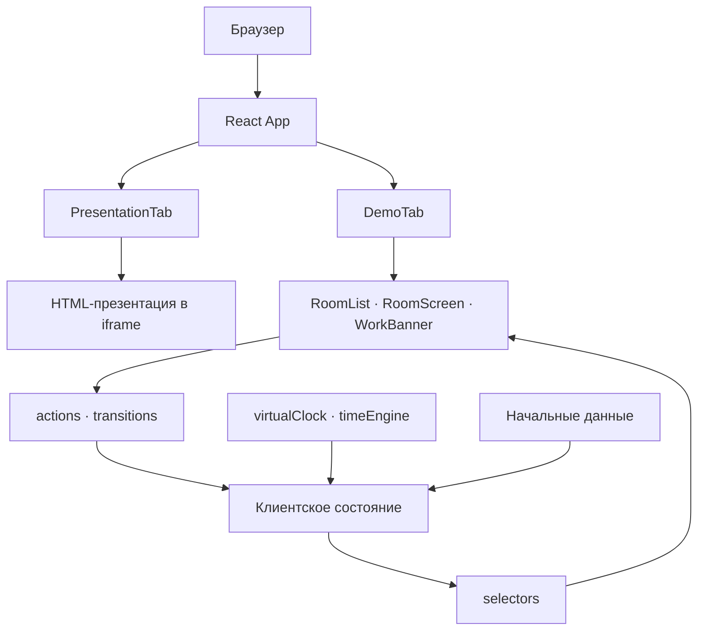

<h1 align="center">УрФУ.Коворкинги</h1>

<p align="center">
  Интерактивный прототип сервиса, который помогает увидеть занятость коворкингов и
  показать, как студенты могут находить и занимать рабочие места.
</p>

<p align="center">
  <a href="https://urfu.qp1kzzzz.workers.dev/">
    
  </a>
  
  
</p>

<p align="center">
  <a href="https://urfu.qp1kzzzz.workers.dev/">🌐 Открыть сайт</a>
  ·
  <a href="https://github.com/qpikzz">Автор: Nikita Shvedov</a>
</p>

> **Важно:** это демонстрационный прототип, а не подключённая к УрФУ.Учёба система. В приложении нет сервера, реальных аккаунтов и сохранения данных: состояние симуляции находится в памяти браузера и сбрасывается после перезагрузки.

## Что внутри

Сайт состоит из двух вкладок:

- **Презентация** — слайдер проекта из 12 слайдов (`00`–`11`), со стрелками, управлением с клавиатуры и свайпами на сенсорном экране, а также QR-ссылками на GitHub, Telegram и VK.
- **Демонстрация** — интерактивная симуляция приложения «Коворкинги»: аудитории, их статусы, участники, таймеры и сценарии занятия.

Интерфейс адаптируется под размер экрана. В демонстрации на мобильном приложение показывается без декоративной рамки телефона. Для элементов интерфейса предусмотрены доступные подписи и состояния фокуса; при `prefers-reduced-motion` анимации сокращаются.

## Быстрый старт

### Требования

- [Node.js](https://nodejs.org/) `20.19.x+` в ветке `20.x` или `22.12+`
- npm (поставляется вместе с Node.js)

### Установка и запуск

```bash
git clone https://github.com/qpikzz/urfu.coworks.git
cd urfu.coworks
npm ci
npm run dev
```

Vite выведет адрес локального сервера в терминал. По умолчанию это `http://localhost:5173/`.

### Команды

| Команда | Результат |
|---|---|
| `npm run dev` | Запустить локальный сервер разработки |
| `npm run build` | Собрать сайт в каталог `dist/` |
| `npm run preview` | Локально посмотреть production-сборку из `dist/` |

В `package.json` пока нет отдельных команд `test` и `lint`.

## Как посмотреть демо

1. Откройте вкладку **Презентация** и листайте слайды стрелками или клавишами `←` / `→`.
2. На слайде «MVP уже готов!» вкладка **Демонстрация** подсказывает, что можно перейти к прототипу.
3. В демонстрации переключайте сессии `user1`, `user2` и `user3`. Поэкспериментируйте со скоростью виртуального времени `×1`, `×5` и `×200`.
4. Найдите аудиторию, выберите действие и посмотрите, как изменяются список участников, статус и таймер.

### Правила симуляции

| Статус | Поведение |
|---|---|
| **Свободно** | Можно занять аудиторию и выбрать режим «Оставить доступным» или «Занять полностью». |
| **Доступно** | Другие демонстрационные сессии могут присоединиться без подтверждения. |
| **Занято** | Для присоединения отправляется заявка; главный участник может её принять или отклонить. |

- В режиме «Занять полностью» запускается таймер подтверждения на **5 виртуальных минут**. Если к его завершению в аудитории меньше двух человек, статус меняется на «Доступно».
- Сессия участника длится **2 виртуальных часа**. Продлить её ещё на 2 часа можно в последние **30 виртуальных минут**.
- Переключатель скорости ускоряет виртуальные часы и таймеры. Он не меняет скорость анимаций интерфейса.
- Для каждой сессии отдельно задаются выбранный вуз, поисковый запрос и состояние сворачиваемых блоков. Список аудиторий и занятость общие для всех трёх сессий.
- Начальные аудитории и демонстрационные участники задаются локальными данными. Имена и время входа участников-заглушек генерируются при запуске; перезагрузка страницы возвращает начальное состояние.

Все данные симуляции демонстрационные: отметка присутствия выполняется вручную, серверной синхронизации и авторизации нет.

## Устройство проекта



Главная оболочка и вкладки реализованы на React. Презентация хранится отдельно в `src/assets/presentation.html`, встраивается в iframe и обменивается с оболочкой сообщениями для синхронизации номера слайда и подсказки перейти к демонстрации. QR-коды презентации встроены как SVG — для их отображения не требуется генератор или библиотека в браузере.

Две вкладки переключаются состоянием React и не являются разными URL-маршрутами. Хеш в адресе презентации используется только для номера слайда внутри iframe.

### Структура каталогов

```text
.
├── index.html                 # HTML-точка входа Vite
├── public/                    # Статические файлы
├── src/
│   ├── App.jsx                # Оболочка и переключение вкладок
│   ├── main.jsx               # Запуск React и движка времени
│   ├── assets/                # HTML-презентация и изображения
│   ├── components/            # Общие шапка и подвал сайта
│   ├── data/                  # Вузы, аудитории, сессии и имена-заглушки
│   ├── features/
│   │   ├── presentation/      # Слайдер презентации
│   │   ├── demo/              # Экран демонстрации и переключатели
│   │   └── coworkings/        # Списки аудиторий и экран комнаты
│   ├── state/                 # Store, actions, transitions, селекторы и часы
│   ├── styles/                # Токены и стили сайта, демо и презентации
│   └── config.js              # Длительности и скорости симуляции
└── openspec/                  # Спецификации продукта и реализации
```

### Основные файлы и документация

- [Описание продукта](./openspec/PRODUCT.md)
- [Сценарии и правила](./openspec/FEATURES.md)
- [Дизайн-система](./openspec/DESIGN.md)
- [План задач](./openspec/TASKS.md)
- [Токены и базовые стили](./src/styles/index.css)
- [Начальные данные аудиторий](./src/data/auditoriums.js)
- [Логика переходов состояния](./src/state/transitions.js)
- [Виртуальные часы и таймеры](./src/state/timeEngine.js)

## Стек

- **React 19** — интерфейс и компоненты.
- **Vite 8** — локальная разработка и production-сборка.
- **JavaScript (ES modules)** — логика клиента и симуляции.
- **CSS** — адаптивная раскладка, токены дизайн-системы и анимации.

Зависимости приложения — React и React DOM. Серверная часть, база данных и обращения к API отсутствуют. HTML-презентация запрашивает Inter через Google Fonts, если сеть доступна; при её отсутствии используются системные шрифты из fallback-стека.

## Данные и настройка

- Вузы и начальные аудитории описаны в `src/data/`.
- Сессии демонстрации и имена участников-заглушек находятся в отдельных файлах данных.
- Длительности сессий, окна продления, подтверждение занятия и скорости виртуального времени задаются в `src/config.js`.
- Общие цвета, типографика, отступы и радиусы определены CSS-переменными в `src/styles/index.css`.
- Переменные окружения для локального запуска не требуются.

Чтобы изменить начальный набор аудиторий или их вместимость, редактируйте данные, а не UI-компоненты. Начальные значения используются для создания нового состояния при загрузке страницы.

## Доступность

- Переключатели, действия и ссылки доступны с клавиатуры и имеют текстовые названия.
- Статусы аудиторий сопровождаются текстом и доступными метками, а не передаются только цветом.
- Диалог выбора режима занятия удерживает фокус внутри и закрывается клавишей `Escape`.
- Для анимаций учитывается системная настройка `prefers-reduced-motion`.

## Разработка

Перед отправкой изменений проверьте, что production-сборка проходит:

```bash
npm ci
npm run build
```

Автоматический test runner и отдельная команда линтера в репозитории пока не настроены. Архитектурные и продуктовые решения описаны в каталоге [`openspec/`](./openspec/).

## Лицензия

### Код

Исходный код распространяется по [MIT License](./LICENSE): `index.html`, `package.json`, `package-lock.json`, `vite.config.js`, `src/App.jsx`, `src/main.jsx`, `src/config.js`, `src/components/`, `src/features/`, `src/data/`, `src/lib/`, `src/state/` и `src/styles/`.

### Материалы презентации и дизайна

Тексты, содержимое слайдов, структура, дизайн и оригинальные иллюстрации распространяются по [Creative Commons Attribution 4.0 International (CC BY 4.0)](https://creativecommons.org/licenses/by/4.0/); условия также приведены в [LICENSE](./LICENSE). К материалам относятся `README.md`, `openspec/` и `src/assets/presentation.html`.

Использование свободное, в том числе коммерческое. Единственное требование — указать авторство Nikita Shvedov и сохранить уведомление о лицензии (в метаданных страницы, комментариях к коду или в видимом месте проекта).

### Сторонние материалы, не покрываются этими лицензиями

- `src/assets/problem-coworking.png` и `src/assets/problem-coworking-wide.png` — скриншоты из видео сообщества «Новости радиофака» во ВКонтакте; права принадлежат правообладателям. [Источник](https://vkvideo.ru/video-49378_456239361).
- Шрифт Inter — [SIL Open Font License 1.1](https://openfontlicense.org/).

Вопросы по лицензии: https://github.com/qpikzz
